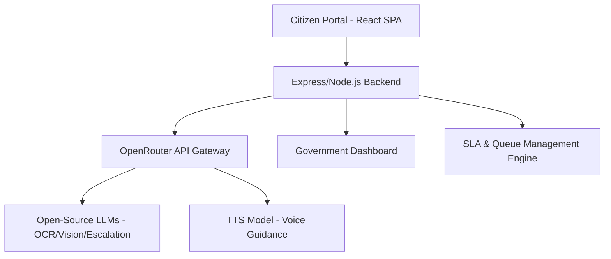

# 🏛️ Sarkari-Sewa: AI Governance Co-Pilot (सरकारी सेवा: सुशासन सह-पाइलट)

Eliminating middleman (bicholiya) exploitation and clerical bottlenecks in Nepalese public administration through multimodal document pre-scrutiny, enforced Citizen Charter SLA timers, and dialect-aware voice guidance.

---

## 📌 Project Overview
Sarkari-Sewa is an automated civic ombudsman and governance co-pilot designed to modernize Nepalese administrative workflows. It bridges the digital divide for rural and marginalized citizens, ensuring transparent, fair, and timely public service delivery.

### The Problem
- **Inefficiency:** Paper-based, opaque processes lead to arbitrary clerical rejections.
- **Predatory Middlemen:** Unmonitored queues allow "bicholiya" (middlemen) to extort citizens for file clearance.
- **Accessibility Barriers:** Lack of clear guidance and language support for non-literate citizens.

### The Solution
A four-pillar intelligent system that empowers citizens and ensures administrative accountability:
1.  **AI Document Pre-Scrutiny:** Instant verification of documents *before* travel.
2.  **SLA Enforcement:** Automated monitoring of legal processing timelines.
3.  **Accountability Escalation:** Formal automated reporting of overdue files to oversight bodies.
4.  **Bilingual AI Voice Guidance:** Multilingual assistance navigating bureaucratic requirements.

---

## 🏗️ System Architecture

The application is structured for resilience, scalability, and auditability.



### Core Components
- **`CitizenPortal` (Frontend):** Step-by-step guidance, OCR document validation, and interactive checklist.
- **`GovernmentDashboard` (Frontend):** FIFO queue management, SLA delay alerts, and escalation tracking.
- **`OCR Engine` (Backend):** Multimodal document processing via OpenRouter.
- **`Escalation Engine` (Backend):** Automated legal petition generation triggered by SLA breaches.
- **`VoiceAssistant` (Component):** Bilingual (Nepali/English) interaction engine powered by TTS/STT APIs.

---

## ✨ Feature List

| Feature | Description | Value Proposition |
| :--- | :--- | :--- |
| **Forensic Pre-Scrutiny** | AI-driven document validation. | Prevents travel for invalid/incomplete applications. |
| **Personalized Remediation** | Step-by-step corrective actions for rejected files. | Empowers citizens to fix errors independently. |
| **SLA Enforcement** | Automated timer for government services. | Ensures adherence to legal deadlines. |
| **Anti-Corruption Escalator**| Auto-generation of formal RTI petitions for delays. | Holds civil servants accountable for stalls. |
| **Multilingual Voice-Pilot** | Speech-to-text/Text-to-speech guidance. | Accessibility for non-literate/rural citizens. |
| **Fee Truth Radar** | Compares official fees vs known market bribes. | Financial transparency, reducing extortion. |

---

## 🏛️ Legal & Constitutional Grounding

Built upon prevailing Nepalese legislation:
*   **Good Governance Act, 2064:** Mandatory adherence to the Citizen Charter.
*   **Right to Information Act, 2064:** Right to written justification for delays.
*   **Prevention of Corruption Act, 2059:** Penalties for intentional delays.
*   **Local Government Operation Act, 2074:** Power for standardized recommendations.

---

## 🛠 Technology Stack
- **Frontend:** React 19, Vite, Tailwind CSS, Lucide Icons, Framer Motion.
- **Backend:** Node.js, Express.js.
- **AI Core:** OpenRouter API (Accessing various open-source models).
- **Voice/Speech:** Web Speech API.

---

## 🤖 How AI Powers Sarkari-Sewa

The core logic uses **LLM-based reasoning** rather than just text generation:
1.  **Reasoning over Evidence:** OCR extracts raw text; the LLM *reasons* about whether a specific citizen's document satisfies the constitutional/legal requirements for a specific application type.
2.  **Dynamic Remediation:** If the `isValidForSelectedTask` flag is false, the model *reasons* about the mismatch to generate personalized diagnostic steps (What is wrong -> How to fix it).
3.  **Automated Accountability:** The escalation engine *reasoning* dynamically drafts formal RTI petitions by parsing the specific administrative delay data point against the *Good Governance Act*.

---

## 🚀 Running the Project Locally

### Prerequisites
- Node.js >= 20.0.0
- npm >= 9.0.0
- An OpenRouter API key

### 1. Installation
```bash
git clone https://github.com/Decoy-ux/hack.git
cd hack
npm install
```

### 2. Configuration
Create a `.env` file in the root directory:
```
OPENROUTER_API_KEY="your-openrouter-api-key-here"
PORT=3000
```

### 3. Start Development
```bash
npm run dev
```

### 4. Build for Production
```bash
npm run build
npm start
```
