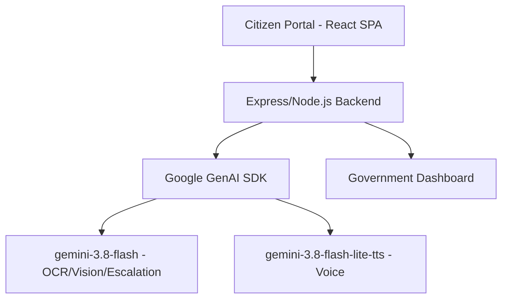

# 🏛️ Sarkari-Sewa: AI Governance Co-Pilot (सरकारी सेवा: सुशासन सह-पाइलट)

Eliminating Middleman (Bicholiya) Exploitation & Clerical Bottlenecks in Nepalese Public Administration Through Multimodal Document Pre-Scrutiny, Enforced Citizen Charter SLA Timers, and Dialect Voice Guidance.

**Public GitHub Repository:** https://github.com/Decoy-ux/hack
**Hackathon Challenge Submission:** AI Governance & Civic Technology Track
**License:** Apache-2.0

---

## 📌 Problem Statement

### Who is Affected?
Over 80% of Nepalese citizens—specifically daily-wage earners, rural farmers, marginalized communities, prospective migrant workers traveling from remote districts, and elderly citizens applying for:
*   🪪 **Citizenship Certificates** (नागरिकता प्रमाणपत्र)
*   🛂 **e-Passports** (राहदानी)
*   📜 **Land Ownership Deeds** (मालपोत / लालपुर्जा)
*   🚗 **Driving Licenses** (सवारी चालक अनुमतिपत्र)
*   🆔 **National ID Cards** (राष्ट्रिय परिचयपत्र / NID)
*   📄 **Ward Vital Event Records** (जन्म, विवाह दर्ता र सिफारिस)

### What Goes Wrong for Them?
Government application procedures in Nepal are heavily paper-based, opaque, and unmonitored. When citizens travel long distances from rural villages to District Administration Offices (DAO) or Land Revenue Offices (Malpot), they wait in queues for days, only to face arbitrary clerical rejections at counters.

These arbitrary rejections create a predatory vacuum where unauthorized middlemen (bicholiya) stationed outside office gates intercept desperate citizens and demand informal "file clearance fees" to grease palms and obtain signatures.

---

## 💡 The Solution: Sarkari-Sewa Governance Co-Pilot

Sarkari-Sewa is an automated civic ombudsman and governance co-pilot that permanently closes these bureaucratic loopholes through four integrated engines:

1.  **Automated Forensic Document Pre-Scrutiny:** A computer vision and OCR engine that scans and verifies application files before citizens leave their village or submit at the counter. It flags missing stamps, blurred signatures, and paper defects, providing instant remediation.
2.  **Cross-Document Discrepancy Matching:** Cross-analyzes secondary documents against citizenship records to catch Devanagari spelling nuances and date calculation errors. It automatically generates compliant petitions.
3.  **Predictive SLA Timers & Anti-Corruption Escalator:** Binds every submitted application to statutory legal deadlines. If a file stalls past the legal deadline without documented cause, the system generates and dispatches a formal anti-corruption dossier to oversight authorities.
4.  **Multilingual Dialect Voice Co-Pilot:** A voice-guided assistant fluent in local languages and dialects—Nepali, Maithili, Bhojpuri, and English—powering guidance for non-literate and rural citizens.

---

## 🤖 How AI Powers Sarkari-Sewa (4 Core Execution Tasks)

| AI Execution Task | Model & Technique | Specific Job Inside Product | Concrete Output |
| :--- | :--- | :--- | :--- |
| **1. Classifying & Extracting** | Gemini Multimodal Vision & OCR | Identifies document types, parses Devanagari script, extracts fields. | Structured digital JSON records. |
| **2. Judging & Verifying** | Multimodal Vision Inspection | Evaluates authenticity, checks resolution, verifies government seals and signatures. | Pre-approval verdict, pinpointed rejection causes, legal remedies. |
| **3. Predicting & Timing** | Predictive SLA Engine | Calculates processing durations, predicts delay risk, detects bottleneck desks. | Real-time SLA clock, middleman risk index, stall alerts. |
| **4. Deciding & Escalating** | Automated Legal Routing Engine | Evaluates stalled files against governance acts, drafts formal petitions. | Automated RTI petitions, oversight authority dispatch letters, CIAA alerts. |

---

## 🏛️ Legal & Constitutional Grounding (Nepal Law)

Sarkari-Sewa's escalation engine is built upon:
*   **Good Governance Act, 2064:** Mandatory adherence to the Public Citizen Charter and officer accountability for unlawful delay.
*   **Right to Information Act, 2064:** Ensures the right to inspect and receive justification for pending administrative files.
*   **Prevention of Corruption Act, 2059:** Penalties for intentional delay with corrupt intent.
*   **Local Government Operation Act, 2074:** Standardized recommendation powers for vital events.

---

## 🏗️ Architecture



## 🚀 Running the Project Locally

### Prerequisites
- Node.js >= 20.0.0
- npm >= 9.0.0
- A Google Gemini API key

### 1. Clone & Install
```bash
git clone https://github.com/Decoy-ux/hack.git
cd hack
npm install
```

### 2. Configure Environment Variables
Create a `.env` file in the root directory:
```
GEMINI_API_KEY="your-gemini-api-key-here"
PORT=3000
```

### 3. Run Development Server
```bash
npm run dev
```
The application will launch at `http://localhost:3000`.

### 4. Build for Production
```bash
npm run build
npm start
```
